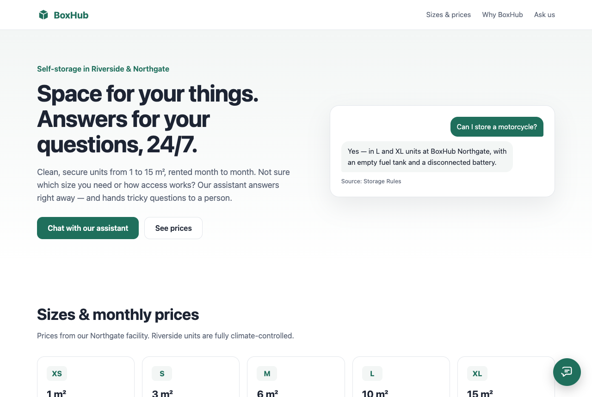
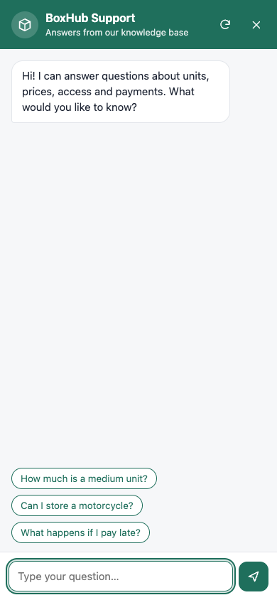
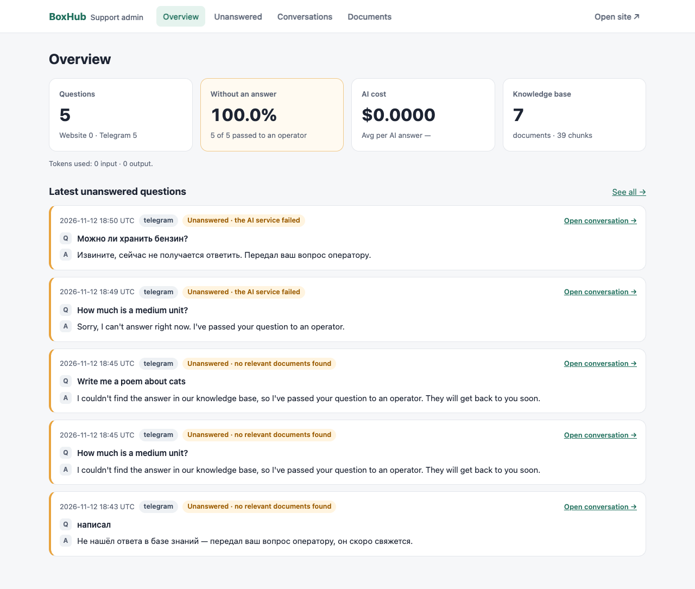

# RAG Support Bot

An AI customer-support assistant that answers questions **only from a company's own documents**, shows the sources of every answer, and hands questions it cannot answer to a human operator. It works as an embeddable website widget and as a Telegram bot, with an admin panel for documents, conversations and costs.

The demo company is **BoxHub Self-Storage**, a fictional storage-unit rental business.

**Live demo:** https://153-52-101-226.sslip.io · Telegram: [@BoxHubSupportBot](https://t.me/BoxHubSupportBot)



## Features

- **Grounded answers.** Retrieval-augmented generation over a knowledge base in PostgreSQL + pgvector. Claude answers strictly from the retrieved documents and returns a structured `answer_found` flag instead of guessing.
- **Sources under every answer**, taken from document metadata, not from the model's text.
- **Human handoff.** When nothing relevant is found, the model says the answer isn't in the documents, or the AI call fails, the user gets a polite reply and the operator gets a Telegram message with a link to the conversation.
- **Streaming everywhere.** Server-sent events in the widget, live message drafts in Telegram.
- **One-line website widget.** `<script src="https://your-host/widget.js" defer></script>` adds a chat button. Plain JavaScript in a Shadow DOM, with no framework and no style conflicts.
- **Telegram bot** on the same answer pipeline as the widget.
- **Admin panel:** documents and uploads (Markdown, TXT, PDF or a web page URL), the full conversation log, an **Unanswered** tab showing the gaps in the knowledge base, and stats on unanswered rate, tokens and AI cost in dollars.
- **Multilingual.** The bot replies in the language of the question, so English documents can answer Russian questions and vice versa.
- **Production basics:** rate limiting per IP and per session, prompt-injection-aware prompts, idempotent document ingestion by content hash, and HTTPS through Caddy.

| Widget (mobile) | Admin overview |
|---|---|
|  |  |

## Architecture

1. `kb ingest` (or an admin upload) splits documents into heading-aware chunks, embeds them locally with **fastembed** and stores them in **PostgreSQL + pgvector**. A content hash keeps re-ingestion idempotent.
2. A question from the widget (`POST /api/chat`, SSE) or from Telegram (aiogram 3) goes to one shared service, `services/answer.py`.
3. The service retrieves the top chunks by cosine similarity. If none pass the threshold, it hands off straight away without calling the LLM.
4. Otherwise **Claude** (Anthropic SDK, structured outputs) streams `{answer_found, answer, source_ids}`. The answer text streams to the user as it is generated, and `stop_reason`, token usage and cost are checked and saved.
5. Unanswered questions are stored with a reason and sent to the operator's Telegram chat. The admin panel reads the same tables.

**Stack:** Python 3.12, FastAPI, SQLAlchemy 2 (async), Alembic, PostgreSQL + pgvector, Redis, aiogram 3, Anthropic SDK, fastembed (`paraphrase-multilingual-mpnet-base-v2`), Jinja2, Docker Compose, Caddy, uv, pytest, ruff, pyright.

## Quick start

Requirements: Docker, plus [uv](https://docs.astral.sh/uv/) for local development.

```bash
cp .env.example .env              # set ANTHROPIC_API_KEY, ADMIN_PASSWORD and optionally Telegram settings
docker compose up -d --build      # API on http://localhost:8000, migrations run automatically
docker compose run --rm api kb ingest data/kb/   # load the BoxHub knowledge base
```

Then open:

- http://localhost:8000: the demo page with the widget
- http://localhost:8000/admin: the admin panel (`ADMIN_USERNAME` / `ADMIN_PASSWORD`)

The first ingest downloads the embedding model (~1 GB) into a Docker volume. The API needs about 1.7 GB of RAM.

### Telegram

Set `TG_BOT_TOKEN` (from @BotFather) and `TG_POLLING_ENABLED=true`. To receive unanswered questions, send `/id` to the bot and put the number into `TG_OPERATOR_CHAT_ID`. The bot runs inside the API process, so a single copy of the embedding model serves both channels. Run polling in one place only: Telegram rejects two pollers with the same token.

### Embedding the widget on another site

```html
<script src="https://your-host/widget.js" data-title="Support" data-color="#1f6f5c" defer></script>
```

Add the site to `CORS_ORIGINS` in `.env`, for example `["https://shop.example"]`.

## Configuration

All settings come from `.env`. See [`.env.example`](.env.example) for the full list with comments. The most important ones:

| Variable | Purpose |
|---|---|
| `ANTHROPIC_API_KEY`, `LLM_MODEL`, `LLM_EFFORT` | Claude access, model (default `claude-opus-5-5`) and effort level |
| `RAG_TOP_K`, `RAG_MIN_SIMILARITY` | How many chunks to retrieve, and the similarity below which the bot hands off without calling the LLM |
| `ADMIN_USERNAME`, `ADMIN_PASSWORD` | Basic auth for `/admin`. Without a password the admin panel is disabled |
| `TG_BOT_TOKEN`, `TG_OPERATOR_CHAT_ID`, `TG_POLLING_ENABLED` | Telegram bot and operator notifications |
| `PUBLIC_BASE_URL`, `SITE_ADDRESS` | Links in operator notifications; the domain Caddy issues a certificate for |
| `RATE_LIMIT_IP_PER_MINUTE`, `RATE_LIMIT_SESSION_PER_MINUTE` | Chat rate limits |

## Deployment

Production adds Caddy with automatic HTTPS. Only ports 80 and 443 are exposed; the database, Redis and the API stay on the internal Docker network.

```bash
# on the server, in the project directory with a production .env (SITE_ADDRESS, strong passwords)
docker compose -f docker-compose.yml -f docker-compose.prod.yml up -d --build
docker compose -f docker-compose.yml -f docker-compose.prod.yml run --rm api kb ingest data/kb/
```

Without a domain, `<ip-with-dashes>.sslip.io` works as `SITE_ADDRESS`. The CLI ingest loads a second copy of the embedding model, so on a small server it needs about 1.7 GB of free RAM on top of the running API. Uploading through the admin panel reuses the API's model and doesn't need that extra memory.

## Development

```bash
uv sync
docker compose up -d db redis
uv run alembic upgrade head
uv run uvicorn support_bot.main:app --reload
uv run pytest                     # database tests use a separate support_bot_test database
uv run ruff check . && uv run ruff format --check . && uv run pyright
```

```
src/support_bot/
  api/        chat (SSE), admin, pages, health: thin FastAPI routes
  services/   answer (RAG pipeline), ingest, handoff, rate limit, stats
  rag/        loaders (md/txt/pdf/url), chunking, embeddings (Embedder interface), search
  llm/        Anthropic client, prompts, pricing, streaming JSON parser
  telegram/   aiogram router, handlers, texts
  db/         models, repositories, session
  web/        widget.js, demo page and admin templates
data/kb/      BoxHub knowledge base (Markdown + PDF)
```

---

BoxHub Self-Storage is a fictional company created for this demo.
